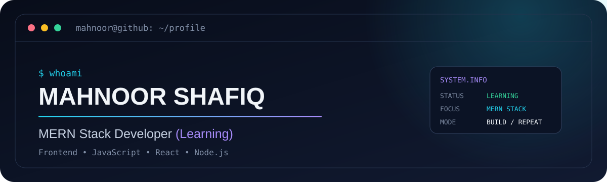

 

### MERN Stack Developer (Learning) · Frontend Developer

Building interfaces, strengthening backend fundamentals, and learning by shipping projects.

---

## `whoami` — About Me

Hi, I'm **Mahnoor Shafiq**. I'm a frontend developer expanding into the **MERN stack**. I enjoy building practical web experiences and improving my understanding of how applications work from the UI to the server and database.

- 🌱 Currently learning **Node.js, Express.js, MongoDB**, and backend development fundamentals.
- 💻 Working with **JavaScript, React, TypeScript**, and modern frontend tooling.
- 🧩 Interested in browser extensions, useful web applications, and clean user experiences.
- 🎯 Goal: become a confident full-stack developer through consistent practice and real projects.

> Learning in public. Building one project at a time.

## `stack --current` — Technologies

**Frontend**

**Backend — learning**

**Tools & libraries used in projects**

## `ls ./projects` — Featured Projects

### 1. Bookmark Manager Extension

A browser extension project built with a modern TypeScript and React toolchain.

**Tech:** React · TypeScript · Vite · Tailwind CSS · Zustand · Dexie · Chrome Extension API

[View repository →](https://github.com/mahnoorshafiq557/bookmark-manager-extension)

### 2. Portfolio

A personal portfolio project built with HTML.

[View repository →](https://github.com/mahnoorshafiq557/portfolio)

### 3. Birthday

A small web project built with HTML.

[View repository →](https://github.com/mahnoorshafiq557/birthday)

---

## `git status` — GitHub Activity

 

## `contributions --snake`

<picture>
  <source media="(prefers-color-scheme: dark)" srcset="https://raw.githubusercontent.com/mahnoorshafiq557/mahnoorshafiq557/output/github-contribution-grid-snake-dark.svg">
  <source media="(prefers-color-scheme: light)" srcset="https://raw.githubusercontent.com/mahnoorshafiq557/mahnoorshafiq557/output/github-contribution-grid-snake.svg">
  
</picture>

---

**Thanks for stopping by!**

`const progress = "keep learning, keep building";`

